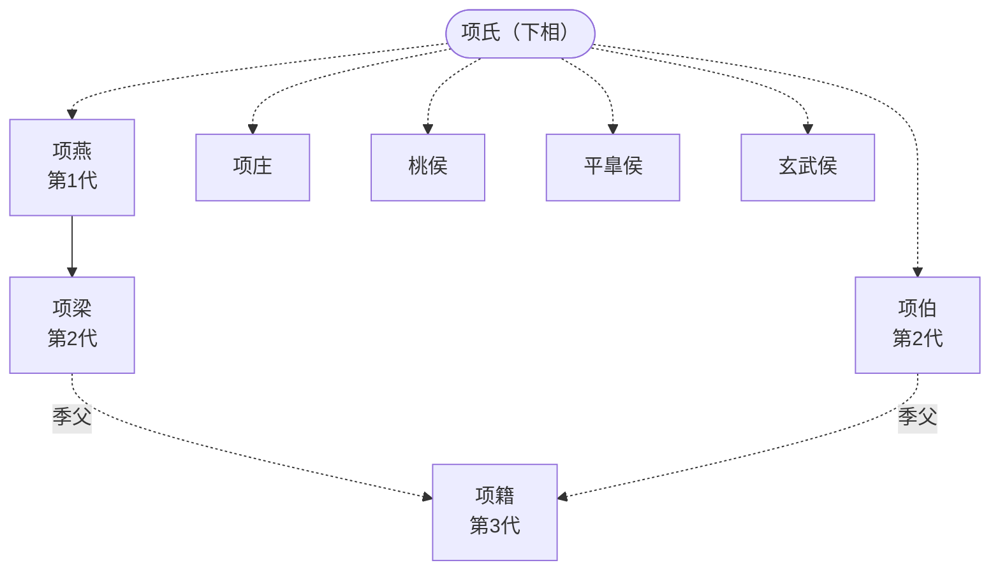

# 项氏（下相）

<!-- 自动生成：开始（勿手改，运行 scripts/reanchor.py 更新） -->

## 世系图

## 成员

| 世代 | 成员 | 关系 |
|---|---|---|
| 1 | 项燕（未立传） | 项梁之父 |
| 2 | 项梁（未立传） | 项燕之子；项籍季父 |
| 2 | [项伯](../人物/史记/项伯.md) | 项籍季父（与项梁同辈，是否同父未载） |
| 3 | 项籍（未立传） | 项梁、项伯之姪（其父未载） |
| 未详 | 项庄（未立传） | 史、汉均未载其与项籍之关系 |
| 未详 | 桃侯（未立传） | 项氏枝属，入汉赐姓刘 |
| 未详 | 平臯侯（未立传） | 项氏枝属，入汉赐姓刘 |
| 未详 | 玄武侯（未立传） | 项氏枝属，入汉赐姓刘 |

<!-- 自动生成：结束 -->

> 项籍者，下相人也，字羽。初起时，年二十四。其季父项梁，梁父即楚将项燕，为秦将王翦所戮者也。项氏世世为楚将，封于项，故姓项氏。〔[史记·7·2](../原文/史记/007.md#p2)〕

> [史记·7·45｜诸项氏枝属，汉王皆不诛。乃封项伯为射阳侯。桃侯、平皋侯、玄武侯皆项氏，赐姓刘。](../原文/史记/007.md#p45)

> [汉书·1下·4｜封项伯等四人为列侯，赐姓刘氏。](../原文/汉书/001下.md#p4)
